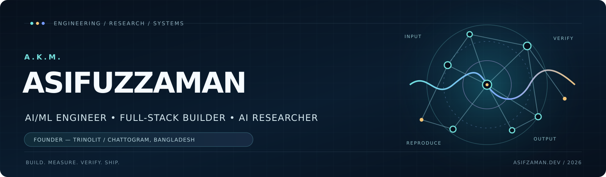
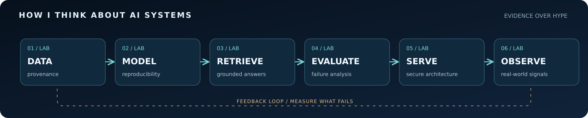
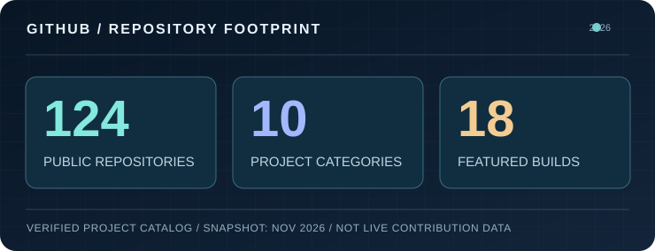
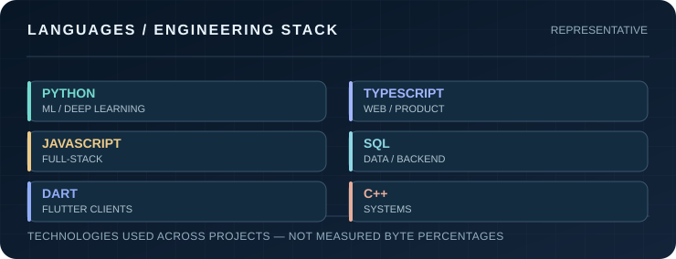

## A.K.M. Asifuzzaman

### Founder, [TrinolIT](https://www.trinolit.com/) &nbsp; · &nbsp; AI/ML Engineer &nbsp; · &nbsp; Full-Stack Developer &nbsp; · &nbsp; AI Researcher

**I engineer AI systems from first principles, evaluate them against reality, and ship interfaces people can actually use.**

Chattogram, Bangladesh &nbsp; | &nbsp; East Delta University, BSc in CSE (in progress) &nbsp; | &nbsp; Applied AI + research-minded software engineering

---

<table>
<tr>
<td width="25%" align="center"><b>19.47M</b> Parameters · scratch-trained transformer</td>
<td width="25%" align="center"><b>97.16%</b> Food-101 · held-out top-1 accuracy</td>
<td width="25%" align="center"><b>20,000</b> InsightVLM · synthetic labeled charts</td>
<td width="25%" align="center"><b>13</b> Specialized agents · OmniMind</td>
</tr>
</table>

These metrics refer to **different projects, datasets and evaluation protocols**, not a combined leaderboard. Follow each linked repository for methodology and limitations.

## 00 / Navigation console

[**About**](#01--about-the-builder) &nbsp; • &nbsp; [**Research**](#02--research-frontier) &nbsp; • &nbsp; [**Flagships**](#03--featured-builds) &nbsp; • &nbsp; [**Engineering**](#04--systems-thinking) &nbsp; • &nbsp; [**All 124 repositories**](#05--complete-public-project-atlas) &nbsp; • &nbsp; [**Skills**](#06--technical-arsenal) &nbsp; • &nbsp; [**Credentials**](#07--education-and-credentials) &nbsp; • &nbsp; [**Contact**](#08--work-with-me)

## 01 / About the builder

I'm **A.K.M. Asifuzzaman** (Asif Zaman), founder of **[TrinolIT](https://www.trinolit.com/)** and a Computer Science & Engineering undergraduate at **East Delta University**. I work where machine learning, evidence-driven research, secure backend architecture and high-quality product engineering meet.

I build across the full stack of intelligence: **dataset design → training → evaluation → retrieval / orchestration → APIs → deployment → user experience**. My interests center on **vision-language models, multimodal reasoning, uncertainty, trustworthy RAG and agentic systems**.

> **My engineering standard:** No benchmark without a protocol. No generated claim without evidence. No "production-ready" badge without tests, security boundaries and a real deployment path.

- **Research direction:** chart reasoning, graph robustness, vision-language evaluation, retrieval, provenance, explainability and calibration.
- **Engineering direction:** PyTorch, FastAPI, PostgreSQL, multi-tenant SaaS, LangGraph, Qdrant, Neo4j, React / Next.js, Docker and observability.
- **Current academic stage:** BSc in CSE in progress; **CGPA 3.79 / 4.00** (last reported September 2026).
- **Open to:** research collaboration, AI/ML engineering roles, ambitious applied-AI work, and thesis-based graduate research.

## 02 / Research frontier

My current work focuses on **what models can reliably infer from visual and structured evidence**—and how to tell when the evidence does *not* support a conclusion.

| Research track | Core question | Project |
|---|---|---|
| **Vision-language reasoning** | Can a model identify a statistically valid finding from a chart rather than merely describe it? | [InsightVLM](https://github.com/A-K-M-Asifuzzaman/InsightVLM) |
| **Graph robustness** | Does graph-question answering preserve topology under redraws and recognize true edge edits? | [TopoDelta-QA](https://github.com/A-K-M-Asifuzzaman/Pattern-Recognition) |
| **Scientific retrieval** | Can contrastive vision-language embeddings retrieve figures in a domain-shifted scientific corpus? | [RoboDesign Atlas](https://github.com/A-K-M-Asifuzzaman/RobotDesign1M) |
| **Reliable prediction** | How do calibration, abstention and conformal sets change the trustworthiness of visual classification? | [FoodGenome AI](https://github.com/A-K-M-Asifuzzaman/Food) |
| **Evidence-grounded generation** | Can an AI assistant prove which document span or audio segment supports each claim? | [DocFlow AI](https://github.com/A-K-M-Asifuzzaman/DocFlow-AI) · [Beacon AI](https://github.com/A-K-M-Asifuzzaman/BEACON-AI) |
| **Low-resource AI** | What is achievable for Chittagonian when real annotated data is scarce? | [ChatgaiyyaLM](https://github.com/A-K-M-Asifuzzaman/Chatgaiya-AI) |

**Research integrity note:** Project README claims are not automatically peer-reviewed results. InsightVLM includes research drafts; TopoDelta-QA is an experimental benchmark-development effort with no human validation or established model-efficacy result. No publication claim is implied here.

## 03 / Featured builds

### Research + engineering, side by side

<table>
<tr>
<td width="50%" valign="top">

<h3>InsightVLM</h3>

<b>Vision-language research · statistical reasoning</b>

20,000 charts; 26 chart types; 20 statistical findings. Labels are grounded in tests on the underlying plotted data, with additional real-data charts and cross-renderer evaluation.

<a href="https://github.com/A-K-M-Asifuzzaman/InsightVLM">Code & methodology</a> · <a href="https://huggingface.co/spaces/AsifZaman1912/InsightVLM">Interactive demo</a>

</td>
<td width="50%" valign="top">

<h3>FoodGenome AI</h3>

<b>Computer vision · conformal prediction · grounded nutrition</b>

<b>97.16%</b> Food-101 test top-1; <b>99.56%</b> measured conformal coverage with average candidate set 1.54; evidence-linked nutrition and RAG.

<a href="https://github.com/A-K-M-Asifuzzaman/Food">Code & evaluation</a> · <a href="https://food-red-omega.vercel.app">Live app</a>

</td>
</tr>
<tr>
<td width="50%" valign="top">

<h3>DocFlow AI</h3>

<b>Document intelligence · auditability · multi-tenancy</b>

Turns documents into deadlines and tasks using a strict chain of <code>document → page → span → bounding box → fact → task</code>. Facts without matching source evidence are not promoted to confirmed actions.

<a href="https://github.com/A-K-M-Asifuzzaman/DocFlow-AI">Architecture & tests</a>

</td>
<td width="50%" valign="top">

<h3>Beacon AI</h3>

<b>Audio intelligence · provenance-first UX</b>

Lecture and meeting summaries with clickable timecodes, speaker-aware sessions, evidence-based action items and claim labels: <code>supported / partial / unsupported</code>.

<a href="https://github.com/A-K-M-Asifuzzaman/BEACON-AI">Code & design</a> · <a href="https://beacon-ai-drab.vercel.app">Live app</a>

</td>
</tr>
</table>

### The engineering showcase

| Project | The engineering problem | Evidence / demonstrated result | Explore |
|---|---|---|---|
| **NWP-Core** | Build, train, quantize and serve an actual transformer—not an API wrapper. | **19.47M params**, ~262M training tokens; ONNX int8 + browser WebAssembly; **58.53%** reported quantized test top-5. | [Source](https://github.com/A-K-M-Asifuzzaman/Next-Word-Prediction-From-Scratch) · [Demo](https://nwp-core.vercel.app) |
| **Recurra** | Prevent target leakage in clinical prediction; explain calibrated outcomes. | **0.892 test PR-AUC** on an at-diagnosis feature track; SHAP and constrained counterfactuals. **Research only; not clinically validated.** | [Source](https://github.com/A-K-M-Asifuzzaman/THYROID-ML-) · [Demo](https://recurra-a-k-m-asifuzzamans-projects.vercel.app) |
| **OmniMind** | Make a multi-agent research system verify the evidence behind its own writing. | **13 agents**; claim-by-claim verification, contradiction checks and **119 passing tests** reported. | [Source](https://github.com/A-K-M-Asifuzzaman/CSE-466-Python-Project) |
| **ShikkhaAI** | Teach with citations anchored to real textbooks in Bangla, English and Banglish. | **18 NCTB books / 4,551 pages** indexed; hybrid retrieval + RRF + reranking; multimodal inputs. | [Source](https://github.com/A-K-M-Asifuzzaman/ShikkhaAI) · [Demo](https://shikkha-ai-lime.vercel.app) |
| **Nexora AI** | Preserve transactional integrity while adding tenant-isolated AI to ERP/POS. | Atomic checkout across sales, stock, payment, VAT, ledger and audit; FastAPI + Postgres + Next.js. | [Source](https://github.com/A-K-M-Asifuzzaman/Nexora-AI) |
| **NeuraHub AI** | Compose an organizational AI workspace without collapsing tenant isolation. | **8 modules / 10 FastAPI microservices** reported; Postgres RLS + Qdrant + Neo4j. | [Source](https://github.com/A-K-M-Asifuzzaman/NeuralHub-AI) |
| **RoadEye** | Avoid partial-label poisoning when training road-distress vision models. | Separate pothole and crack supervision; condition scoring and explainable repair support. | [Source](https://github.com/A-K-M-Asifuzzaman/Road) |
| **ImageIQ** | Bring detection, semantic search and data annotation into a single operator workflow. | YOLOv8 + CLIP + FAISS; COCO/YOLO/VOC export and review queue. | [Source](https://github.com/A-K-M-Asifuzzaman/IMAGEIQ) · [Demo](https://imageiq.vercel.app) |
| **RoboDesign Atlas** | Search domain-specific scientific figures with measurable embedding quality. | Domain-adaptive CLIP, FAISS retrieval and corpus composition audit. | [Source](https://github.com/A-K-M-Asifuzzaman/RobotDesign1M) · [Demo](https://asifzaman1912-robodesign-atlas.static.hf.space) |
| **ChatgaiyyaLM** | Design language adaptation experiments for data-scarce Chittagonian. | **13,497-item / eight-task** benchmark; corpus deduplication and held-out checks. | [Source](https://github.com/A-K-M-Asifuzzaman/Chatgaiya-AI) |
| **Kage** | Build a private cross-platform messenger with clear trust boundaries. | Flutter clients + NestJS realtime backend; privacy and connection-controlled messaging. | [Source](https://github.com/A-K-M-Asifuzzaman/Personal_Chatting_App) |
| **Direct** | Move large files device-to-device without storing payloads on an upload server. | WebRTC data channels + WebSocket signaling, chunking and backpressure; **100 GB is a design target**, not a measured guarantee. | [Source](https://github.com/A-K-M-Asifuzzaman/File_Shareing) |
| **DataSense AI v3** | Make the data science lifecycle auditable inside a web product. | Cleaning, profiling, AutoML, SHAP, forecasting, anomaly detection, reports and AI chat. | [Source](https://github.com/A-K-M-Asifuzzaman/DataSense-AI-V3) |
| **Meridian** | Build an isolated multi-merchant commerce analytics platform. | React + Express + MongoDB; per-store products, orders, users and BDT support. | [Source](https://github.com/A-K-M-Asifuzzaman/Meridian) |
| **DevMesh** | Turn developer profiles into a collaborative environment. | Team chat, matching, Kanban and recruiter discovery. | [Source](https://github.com/A-K-M-Asifuzzaman/DevMesh) |
| **PriceRadar** | Track market pricing as an actual monitored data pipeline. | Playwright extraction, schedulers, historical records and multi-channel alerts. | [Source](https://github.com/A-K-M-Asifuzzaman/PriceRadar) |

### Experiments and honest boundaries

<b>View research pilots, evolving systems and validation limitations</b>

| Project | What is implemented / explored | Boundary |
|---|---|---|
| [TopoDelta-QA](https://github.com/A-K-M-Asifuzzaman/Pattern-Recognition) | Synthetic topology-edit graph QA, audit and training-pilot tools | **No human validation** and no established efficacy claim; research still being prepared. |
| [MicroFire Atlas](https://github.com/A-K-M-Asifuzzaman/MicroFire-Atlas) | Evidence-focused NASA microgravity flame observatory | Not a physical simulation, a probability engine or a material-safety rating. |
| [MicroFire V2](https://github.com/A-K-M-Asifuzzaman/MicroFire-V2) | Science contracts and a living observatory / mission-game foundation | Repository explicitly states the full research engine and playable game are **not yet complete**. |
| [Trinol Browser](https://github.com/A-K-M-Asifuzzaman/TRINOL-BROWSER) | Chromium build and native browser experiments | Native UI and repeatable single-instance lifecycle acceptance still **partial**. |

## 04 / Systems thinking

| What I optimize for | How it appears in the projects |
|---|---|
| **Evidence & provenance** | Source spans, page numbers, timestamps, reproducible experimental splits. |
| **Correctness under failure** | Refusals, abstention, uncertainty estimation, leakage audits, adversarial testing. |
| **Production boundaries** | RBAC/RLS, tenant isolation, signed integration surfaces, typed APIs and safe defaults. |
| **Measurement** | Held-out metrics, paired tests, telemetry, calibration, CI, regression suites and detailed limitations. |
| **Product usefulness** | Real workflows, understandable interfaces, export paths and accessible interaction patterns. |

### TrinolIT — company and systems engineering

As the founder of **[TrinolIT](https://www.trinolit.com/)**, I work across product strategy, systems architecture, AI integration and backend engineering. Public work includes [Nexora AI](https://github.com/A-K-M-Asifuzzaman/Nexora-AI) and the [TrinolIT website](https://www.trinolit.com/). **Trinol OS** (internal operations) and **Trinol Payment** (payment reconciliation) are private initiatives; source code and internal links are intentionally not published on this profile.

## 05 / Complete public project atlas

**124 public repositories · 10 project families · one entry for every repository.** This includes flagship systems, experiments, course projects, older iterations and this profile repository. Open a section to browse its individual repos, or go to the [full-size project index](./docs/PROJECTS.md).

Grouped by primary purpose; projects that cross disciplines appear in one category only to avoid duplicate counts. Descriptions based on repository docs or names are deliberately conservative where detailed evidence is unavailable.

<b>01 · Vision-Language Research & Benchmarks &nbsp; (9 repos)</b>

| Repository | What it covers |
|---|---|
| [**InsightVLM**](https://github.com/A-K-M-Asifuzzaman/InsightVLM) `InsightVLM` | Statistical insight classification from chart images; 20K-chart benchmark with test-verified labels. |
| [**TopoDelta-QA**](https://github.com/A-K-M-Asifuzzaman/Pattern-Recognition) `Pattern-Recognition` | Topology-change graph QA dataset and evaluation tooling; research pilot, not a published benchmark. |
| [**RoboDesign Atlas**](https://github.com/A-K-M-Asifuzzaman/RobotDesign1M) `RobotDesign1M` | Scientific-figure retrieval, domain-adaptive CLIP, corpus audit and browser demo. |
| [**NWP-Core**](https://github.com/A-K-M-Asifuzzaman/Next-Word-Prediction-From-Scratch) `Next-Word-Prediction-From-Scratch` | 19.47M-parameter decoder-only transformer; ONNX/WASM browser inference. |
| [**Machine Learning Reference**](https://github.com/A-K-M-Asifuzzaman/Machine-Learning) `Machine-Learning` | From-scratch ML implementations, derivations and reproducible notebooks. |
| [**NN PS 1**](https://github.com/A-K-M-Asifuzzaman/NN-PS-1) `NN-PS-1` | Learning project / experiment; consult repository for scope. |
| [**NN PS 2**](https://github.com/A-K-M-Asifuzzaman/NN-PS-2) `NN-PS-2` | Learning project / experiment; consult repository for scope. |
| [**XAI**](https://github.com/A-K-M-Asifuzzaman/XAI) `XAI` | Learning project / experiment; consult repository for scope. |
| [**KaggleSolve**](https://github.com/A-K-M-Asifuzzaman/KaggleSolve) `KaggleSolve` | Learning project / experiment; consult repository for scope. |

<b>02 · Agentic AI, RAG & Knowledge Systems &nbsp; (9 repos)</b>

| Repository | What it covers |
|---|---|
| [**DocFlow AI**](https://github.com/A-K-M-Asifuzzaman/DocFlow-AI) `DocFlow-AI` | Document-to-action intelligence with source-span provenance and verified extraction. |
| [**OmniMind**](https://github.com/A-K-M-Asifuzzaman/CSE-466-Python-Project) `CSE-466-Python-Project` | 13-agent multimodal research and evidence-verification platform. |
| [**ShikkhaAI**](https://github.com/A-K-M-Asifuzzaman/ShikkhaAI) `ShikkhaAI` | SSC textbook-grounded multilingual agentic RAG tutor. |
| [**AIZen Tutor**](https://github.com/A-K-M-Asifuzzaman/AIZen-Tutor) `AIZen-Tutor` | Gamified AI/ML learning platform with lessons and document RAG. |
| [**NeuraHub AI**](https://github.com/A-K-M-Asifuzzaman/NeuralHub-AI) `NeuralHub-AI` | Multi-tenant AI workspace spanning codebase intelligence, RAG, agents and analytics. |
| [**Advanced RAG**](https://github.com/A-K-M-Asifuzzaman/Advanced_Rag) `Advanced_Rag` | Retrieval-augmented generation practice and experiments. |
| [**Jarvis**](https://github.com/A-K-M-Asifuzzaman/Jarvis) `Jarvis` | Learning project / experiment; consult repository for scope. |
| [**chatbot2**](https://github.com/A-K-M-Asifuzzaman/chatbot2) `chatbot2` | Learning project / experiment; consult repository for scope. |
| [**bot**](https://github.com/A-K-M-Asifuzzaman/bot) `bot` | Learning project / experiment; consult repository for scope. |

<b>03 · Computer Vision & Image Intelligence &nbsp; (4 repos)</b>

| Repository | What it covers |
|---|---|
| [**FoodGenome AI**](https://github.com/A-K-M-Asifuzzaman/Food) `Food` | Food-101 classifier, calibrated predictions, conformal sets and nutrition RAG. |
| [**RoadEye**](https://github.com/A-K-M-Asifuzzaman/Road) `Road` | Road distress detection/segmentation with condition scoring and repair support. |
| [**ImageIQ**](https://github.com/A-K-M-Asifuzzaman/IMAGEIQ) `IMAGEIQ` | YOLO detection, CLIP search, auto-labeling and annotation export. |
| [**Car Damage Detection**](https://github.com/A-K-M-Asifuzzaman/car-damage-detection) `car-damage-detection` | Computer-vision work on detecting vehicle damage. |

<b>04 · Language, Audio & NLP &nbsp; (6 repos)</b>

| Repository | What it covers |
|---|---|
| [**ChatgaiyyaLM**](https://github.com/A-K-M-Asifuzzaman/Chatgaiya-AI) `Chatgaiya-AI` | Low-resource Chittagonian language resources, benchmarks and adaptation work. |
| [**Beacon AI**](https://github.com/A-K-M-Asifuzzaman/BEACON-AI) `BEACON-AI` | Meeting/lecture intelligence with timestamped evidence attribution. |
| [**Speech Recognition LSTM**](https://github.com/A-K-M-Asifuzzaman/Speech_Reco_LSTM) `Speech_Reco_LSTM` | Sequence-model speech recognition experiment. |
| [**Kotodama**](https://github.com/A-K-M-Asifuzzaman/Emotion-Detection-Text-) `Emotion-Detection-Text-` | Emotion classification with transformers and a dynamic visual frontend. |
| [**Spam Detection**](https://github.com/A-K-M-Asifuzzaman/Spam-Detection) `Spam-Detection` | Text spam classification backend/experiments. |
| [**Spam Detection UI**](https://github.com/A-K-M-Asifuzzaman/Spam-Detection-Ui) `Spam-Detection-Ui` | Frontend for the spam classification experiment. |

<b>05 · Applied ML, AutoML & Predictive Analytics &nbsp; (14 repos)</b>

| Repository | What it covers |
|---|---|
| [**Recurra**](https://github.com/A-K-M-Asifuzzaman/THYROID-ML-) `THYROID-ML-` | Leakage-aware thyroid recurrence ML and SHAP explanations; research only. |
| [**DataSense AI v3**](https://github.com/A-K-M-Asifuzzaman/DataSense-AI-V3) `DataSense-AI-V3` | Full-stack data quality, EDA, AutoML, SHAP and reporting platform. |
| [**Student Dropout & Success**](https://github.com/A-K-M-Asifuzzaman/Student-Dropout-and-Academic-Success-Prediction-Using-Data-Analysis-Machine-Learning) `Student-Dropout-and-Academic-Success-Prediction-Using-Data-Analysis-Machine-Learning` | UCI student-outcome modelling with a Streamlit analytics/prediction interface. |
| [**Credit risk model**](https://github.com/A-K-M-Asifuzzaman/Credit_risk_model) `Credit_risk_model` | Credit-risk modelling and related iteration/notebook. |
| [**Credit risk model 2**](https://github.com/A-K-M-Asifuzzaman/Credit_risk_model_2) `Credit_risk_model_2` | Credit-risk modelling and related iteration/notebook. |
| [**Credit Risk Modelling with notebook**](https://github.com/A-K-M-Asifuzzaman/Credit_Risk_Modelling_with_notebook) `Credit_Risk_Modelling_with_notebook` | Credit-risk modelling and related iteration/notebook. |
| [**Health Premium Insurance**](https://github.com/A-K-M-Asifuzzaman/Health_Premium_Insurance) `Health_Premium_Insurance` | Health-insurance premium prediction project or iteration. |
| [**Health Insurance Premium 2.0**](https://github.com/A-K-M-Asifuzzaman/Health_Insurance_Premium_2.0) `Health_Insurance_Premium_2.0` | Health-insurance premium prediction project or iteration. |
| [**Health Care Premium Prediction**](https://github.com/A-K-M-Asifuzzaman/Health-Care-Premium-Prediction) `Health-Care-Premium-Prediction` | Health-insurance premium prediction project or iteration. |
| [**Student Hsc Result Prediction**](https://github.com/A-K-M-Asifuzzaman/Student-Hsc-Result-Prediction) `Student-Hsc-Result-Prediction` | Learning project / experiment; consult repository for scope. |
| [**Car Prediction notebook**](https://github.com/A-K-M-Asifuzzaman/Car_Prediction_notebook) `Car_Prediction_notebook` | Learning project / experiment; consult repository for scope. |
| [**Lead pred**](https://github.com/A-K-M-Asifuzzaman/Lead_pred) `Lead_pred` | Learning project / experiment; consult repository for scope. |
| [**linear regression test**](https://github.com/A-K-M-Asifuzzaman/linear_regression_test) `linear_regression_test` | Learning project / experiment; consult repository for scope. |
| [**Water Potability Prediction**](https://github.com/A-K-M-Asifuzzaman/Is-the-Water-Drinkable-) `Is-the-Water-Drinkable-` | SVC-based potable/non-potable classification with a Gradio UI. |

<b>06 · Recommender Systems &nbsp; (5 repos)</b>

| Repository | What it covers |
|---|---|
| [**Recommendation System**](https://github.com/A-K-M-Asifuzzaman/Recommendation_System) `Recommendation_System` | Recommendation-system implementation or experiment. |
| [**CineMatch AI**](https://github.com/A-K-M-Asifuzzaman/Recommendation_System_ui) `Recommendation_System_ui` | React frontend for ML-based movie recommendations. |
| [**RS**](https://github.com/A-K-M-Asifuzzaman/RS) `RS` | Recommendation-system implementation or experiment. |
| [**Movie Recommendetion System Notebook**](https://github.com/A-K-M-Asifuzzaman/Movie_Recommendetion_System_Notebook) `Movie_Recommendetion_System_Notebook` | Recommendation-system notebook and experiments. |
| [**Book Recommendetion System Notebook**](https://github.com/A-K-M-Asifuzzaman/Book_Recommendetion_System_Notebook) `Book_Recommendetion_System_Notebook` | Recommendation-system notebook and experiments. |

<b>07 · Enterprise SaaS, Platforms & Developer Tools &nbsp; (11 repos)</b>

| Repository | What it covers |
|---|---|
| [**Nexora AI**](https://github.com/A-K-M-Asifuzzaman/Nexora-AI) `Nexora-AI` | Multi-tenant ERP/POS with accounting, AI copilot, forecasting and tenant-scoped RAG. |
| [**Meridian**](https://github.com/A-K-M-Asifuzzaman/Meridian) `Meridian` | Ecommerce analytics and multi-tenant merchant operations platform. |
| [**PriceRadar**](https://github.com/A-K-M-Asifuzzaman/PriceRadar) `PriceRadar` | Price monitoring, alerts, trend analysis and web scraping platform. |
| [**DevMesh AI**](https://github.com/A-K-M-Asifuzzaman/DevMesh) `DevMesh` | Developer collaboration, teammate matching, teams and recruitment tools. |
| [**Kage**](https://github.com/A-K-M-Asifuzzaman/Personal_Chatting_App) `Personal_Chatting_App` | Flutter/NestJS real-time cross-platform messaging platform. |
| [**Trinol Browser**](https://github.com/A-K-M-Asifuzzaman/TRINOL-BROWSER) `TRINOL-BROWSER` | Chromium native browser fork; validated build, incomplete visual/lifecycle acceptance. |
| [**Direct**](https://github.com/A-K-M-Asifuzzaman/File_Shareing) `File_Shareing` | WebRTC browser-to-browser file transfer with signaling and backpressure. |
| [**Nexus**](https://github.com/A-K-M-Asifuzzaman/Nexus) `Nexus` | Learning project / experiment; consult repository for scope. |
| [**PH University**](https://github.com/A-K-M-Asifuzzaman/PH-University) `PH-University` | University-oriented application exercise. |
| [**EDU Project Showcase**](https://github.com/A-K-M-Asifuzzaman/EDU-ProjectShowcase) `EDU-ProjectShowcase` | University project showcase application. |
| [**uni routine personal**](https://github.com/A-K-M-Asifuzzaman/uni-routine-personal) `uni-routine-personal` | Learning project / experiment; consult repository for scope. |

<b>08 · NASA Space Apps, IoT & Embedded Systems &nbsp; (11 repos)</b>

| Repository | What it covers |
|---|---|
| [**MicroFire Atlas**](https://github.com/A-K-M-Asifuzzaman/MicroFire-Atlas) `MicroFire-Atlas` | NASA Space Apps 2026; microgravity flame data, source-grounded evidence exploration. |
| [**MicroFire V2**](https://github.com/A-K-M-Asifuzzaman/MicroFire-V2) `MicroFire-V2` | Living Science Observatory foundation; mission-game/research engine still in development. |
| [**CosmoMinds NASA Challenge**](https://github.com/A-K-M-Asifuzzaman/cosmo-mind-nasa-app-challenge) `cosmo-mind-nasa-app-challenge` | NASA challenge application and team work. |
| [**TeamCosmoMinds**](https://github.com/A-K-M-Asifuzzaman/TeamCosmoMinds) `TeamCosmoMinds` | Learning project / experiment; consult repository for scope. |
| [**cosmo update**](https://github.com/A-K-M-Asifuzzaman/cosmo-update) `cosmo-update` | Learning project / experiment; consult repository for scope. |
| [**CosmoMinds Chatbot**](https://github.com/A-K-M-Asifuzzaman/cosmomind-chatboat) `cosmomind-chatboat` | Chatbot supporting the CosmoMinds project. |
| [**iot**](https://github.com/A-K-M-Asifuzzaman/iot) `iot` | IoT or embedded systems project/iteration. |
| [**iot v2**](https://github.com/A-K-M-Asifuzzaman/iot_v2) `iot_v2` | IoT or embedded systems project/iteration. |
| [**IOT2022**](https://github.com/A-K-M-Asifuzzaman/IOT2022) `IOT2022` | IoT or embedded systems project/iteration. |
| [**Health IoT**](https://github.com/A-K-M-Asifuzzaman/Health_IoT) `Health_IoT` | Connected health sensing prototype. |
| [**STTP**](https://github.com/A-K-M-Asifuzzaman/STTP) `STTP` | Learning project / experiment; consult repository for scope. |

<b>09 · Full-Stack, EdTech & Client Work &nbsp; (19 repos)</b>

| Repository | What it covers |
|---|---|
| [**BookBarn**](https://github.com/A-K-M-Asifuzzaman/BooKBarn) `BooKBarn` | Book commerce application (earlier iteration). |
| [**BookBarn Server**](https://github.com/A-K-M-Asifuzzaman/BookBarn-Server) `BookBarn-Server` | BookBarn backend repository. |
| [**BookBarn Client (final)**](https://github.com/A-K-M-Asifuzzaman/bookbarn-client-final) `bookbarn-client-final` | Later BookBarn frontend iteration. |
| [**BookBarn Server (final)**](https://github.com/A-K-M-Asifuzzaman/bookbarn-final-server) `bookbarn-final-server` | Later BookBarn backend iteration. |
| [**Pet Adoption Client**](https://github.com/A-K-M-Asifuzzaman/Pet-Adoption-client) `Pet-Adoption-client` | Pet adoption web client. |
| [**Pet Adoption Server**](https://github.com/A-K-M-Asifuzzaman/pet-adoption-server) `pet-adoption-server` | Pet adoption backend. |
| [**stayvista**](https://github.com/A-K-M-Asifuzzaman/stayvista) `stayvista` | Learning project / experiment; consult repository for scope. |
| [**News portal**](https://github.com/A-K-M-Asifuzzaman/News-portal) `News-portal` | Learning project / experiment; consult repository for scope. |
| [**hunting phone api**](https://github.com/A-K-M-Asifuzzaman/hunting-phone-api) `hunting-phone-api` | Learning project / experiment; consult repository for scope. |
| [**jhakana shop**](https://github.com/A-K-M-Asifuzzaman/jhakana-shop) `jhakana-shop` | Learning project / experiment; consult repository for scope. |
| [**g3 architects website p**](https://github.com/A-K-M-Asifuzzaman/g3-architects-website-p) `g3-architects-website-p` | Learning project / experiment; consult repository for scope. |
| [**Heaven Furniture Mart**](https://github.com/A-K-M-Asifuzzaman/Hackathon) `Hackathon` | Next.js furniture business landing page. |
| [**web developer portfolio**](https://github.com/A-K-M-Asifuzzaman/web-developer-portfolio) `web-developer-portfolio` | Learning project / experiment; consult repository for scope. |
| [**Asif Zaman**](https://github.com/A-K-M-Asifuzzaman/Asif-Zaman) `Asif-Zaman` | Learning project / experiment; consult repository for scope. |
| [**my simple website**](https://github.com/A-K-M-Asifuzzaman/my-simple-website) `my-simple-website` | Learning project / experiment; consult repository for scope. |
| [**simple landing design**](https://github.com/A-K-M-Asifuzzaman/simple-landing-design) `simple-landing-design` | Learning project / experiment; consult repository for scope. |
| [**AI English Learning**](https://github.com/A-K-M-Asifuzzaman/Language_Learning) `Language_Learning` | AI vocabulary, grammar, speaking and writing practice platform. |
| [**quiz hero**](https://github.com/A-K-M-Asifuzzaman/quiz-hero) `quiz-hero` | Learning project / experiment; consult repository for scope. |
| [**geometry genius**](https://github.com/A-K-M-Asifuzzaman/geometry-genius) `geometry-genius` | Learning project / experiment; consult repository for scope. |

<b>10 · Early Web Development, Programming & Coursework &nbsp; (36 repos)</b>

| Repository | What it covers |
|---|---|
| [**GitHub Profile Source**](https://github.com/A-K-M-Asifuzzaman/A-K-M-Asifuzzaman) `A-K-M-Asifuzzaman` | This profile README and GitHub profile assets. |
| [**Alpha Clash pro**](https://github.com/A-K-M-Asifuzzaman/Alpha-Clash-pro) `Alpha-Clash-pro` | Learning project / experiment; consult repository for scope. |
| [**anomus**](https://github.com/A-K-M-Asifuzzaman/anomus) `anomus` | Learning project / experiment; consult repository for scope. |
| [**Assignment 10 clinet**](https://github.com/A-K-M-Asifuzzaman/Assignment-10-clinet) `Assignment-10-clinet` | Course assignment: client/server component. |
| [**Assignment 10 server**](https://github.com/A-K-M-Asifuzzaman/Assignment-10-server) `Assignment-10-server` | Course assignment: client/server component. |
| [**Assignment 11 clinet**](https://github.com/A-K-M-Asifuzzaman/Assignment-11-clinet) `Assignment-11-clinet` | Course assignment: client/server component. |
| [**Assignment 11 server**](https://github.com/A-K-M-Asifuzzaman/Assignment-11-server) `Assignment-11-server` | Course assignment: client/server component. |
| [**Assignment 12 client**](https://github.com/A-K-M-Asifuzzaman/Assignment-12-client) `Assignment-12-client` | Course assignment: client/server component. |
| [**Assignment 12 server**](https://github.com/A-K-M-Asifuzzaman/Assignment-12-server) `Assignment-12-server` | Course assignment: client/server component. |
| [**Assignment 2**](https://github.com/A-K-M-Asifuzzaman/Assignment-2) `Assignment-2` | Full-stack / frontend course assignment. |
| [**Assignment 3**](https://github.com/A-K-M-Asifuzzaman/Assignment-3) `Assignment-3` | Full-stack / frontend course assignment. |
| [**Assignment 5**](https://github.com/A-K-M-Asifuzzaman/Assignment-5) `Assignment-5` | Full-stack / frontend course assignment. |
| [**Assignment 6**](https://github.com/A-K-M-Asifuzzaman/Assignment-6) `Assignment-6` | Full-stack / frontend course assignment. |
| [**Assignment 7**](https://github.com/A-K-M-Asifuzzaman/Assignment-7) `Assignment-7` | Full-stack / frontend course assignment. |
| [**assignment 9**](https://github.com/A-K-M-Asifuzzaman/assignment-9) `assignment-9` | Full-stack / frontend course assignment. |
| [**Assingment 1**](https://github.com/A-K-M-Asifuzzaman/Assingment-1) `Assingment-1` | Full-stack / frontend course assignment. |
| [**My Assignment 8**](https://github.com/A-K-M-Asifuzzaman/My-Assignment-8) `My-Assignment-8` | Full-stack / frontend course assignment. |
| [**First Project**](https://github.com/A-K-M-Asifuzzaman/First-Project) `First-Project` | Learning project / experiment; consult repository for scope. |
| [**ft p**](https://github.com/A-K-M-Asifuzzaman/ft-p) `ft-p` | Learning project / experiment; consult repository for scope. |
| [**git ex**](https://github.com/A-K-M-Asifuzzaman/git-ex) `git-ex` | Learning project / experiment; consult repository for scope. |
| [**Level 2 Assignment 2**](https://github.com/A-K-M-Asifuzzaman/Level-2-Assignment-2) `Level-2-Assignment-2` | Full-stack / frontend course assignment. |
| [**more js concepts**](https://github.com/A-K-M-Asifuzzaman/more-js-concepts) `more-js-concepts` | Learning project / experiment; consult repository for scope. |
| [**special dom**](https://github.com/A-K-M-Asifuzzaman/special-dom) `special-dom` | Learning project / experiment; consult repository for scope. |
| [**my file**](https://github.com/A-K-M-Asifuzzaman/my-file) `my-file` | Learning project / experiment; consult repository for scope. |
| [**my first github repo**](https://github.com/A-K-M-Asifuzzaman/my-first-github-repo) `my-first-github-repo` | Learning project / experiment; consult repository for scope. |
| [**problem will never last**](https://github.com/A-K-M-Asifuzzaman/problem-will-never-last) `problem-will-never-last` | Learning project / experiment; consult repository for scope. |
| [**practice for assignment**](https://github.com/A-K-M-Asifuzzaman/practice-for-assignment) `practice-for-assignment` | Learning project / experiment; consult repository for scope. |
| [**dummy repo**](https://github.com/A-K-M-Asifuzzaman/dummy-repo) `dummy-repo` | Learning project / experiment; consult repository for scope. |
| [**rahul jha98**](https://github.com/A-K-M-Asifuzzaman/rahul-jha98) `rahul-jha98` | Learning project / experiment; consult repository for scope. |
| [**cheesits456**](https://github.com/A-K-M-Asifuzzaman/cheesits456) `cheesits456` | Learning project / experiment; consult repository for scope. |
| [**Templates**](https://github.com/A-K-M-Asifuzzaman/Templates) `Templates` | Learning project / experiment; consult repository for scope. |
| [**The Perfect Guess**](https://github.com/A-K-M-Asifuzzaman/The_Perfect_Guess) `The_Perfect_Guess` | Learning project / experiment; consult repository for scope. |
| [**Snake Water Gun Game**](https://github.com/A-K-M-Asifuzzaman/Snake_Water_Gun_Game) `Snake_Water_Gun_Game` | Learning project / experiment; consult repository for scope. |
| [**XPSC**](https://github.com/A-K-M-Asifuzzaman/XPSC) `XPSC` | Learning project / experiment; consult repository for scope. |
| [**html css session**](https://github.com/A-K-M-Asifuzzaman/html-css-session) `html-css-session` | Learning project / experiment; consult repository for scope. |
| [**HTML5 INTRO**](https://github.com/A-K-M-Asifuzzaman/HTML5-INTRO) `HTML5-INTRO` | Learning project / experiment; consult repository for scope. |

## 06 / Technical arsenal

| Layer | Primary tools and approaches |
|---|---|
| **Model training** | Python · PyTorch · TensorFlow / Keras · scikit-learn · XGBoost · LightGBM · Optuna · ONNX |
| **Vision & multimodal** | ViT · CLIP / SigLIP · OpenCV · YOLO · Grad-CAM · visual reasoning |
| **Retrieval & agents** | LangChain · LangGraph · FAISS · Qdrant · Neo4j · hybrid search · RRF · rerankers · agent evaluation |
| **Research rigor** | Reproducible splits · leakage auditing · confidence calibration · conformal prediction · ablations · SHAP · significance testing |
| **Backend & data** | FastAPI · Python · Node.js · NestJS · PostgreSQL / RLS · MongoDB · Redis · Celery · REST / SSE / WebSockets |
| **Product engineering** | TypeScript · React · Next.js · Flutter · Tailwind CSS · Firebase · UX engineering |
| **Shipping & reliability** | Docker · GitHub Actions · Linux · CI / tests · telemetry · authentication / RBAC · observability |

<b>GitHub portfolio snapshot and engineering languages</b>

  
  

Self-hosted graphics, not third-party live stat cards. Repository counts reflect the November 2026 catalog; language badges describe the stack, not percentage of code written. For live contributions, see my <a href="https://github.com/A-K-M-Asifuzzaman">GitHub profile</a>.

## 07 / Education and credentials

**East Delta University** · BSc in Computer Science & Engineering *(in progress)* · Chattogram, Bangladesh  
**CGPA:** 3.79/4.00 (last reported September 2026) · **IEEE Student Member**

**Selected training**: Advanced RAG (ongoing), Deep Learning for Computer Vision (ongoing), Explainable AI, Docker for ML, FastAPI for ML, deep learning, supervised machine learning and full-stack web development.

<b>View course credential links</b>

| Certification | Provider | Year | Credential |
|---|---|---:|---|
| **Docker for Machine Learning** | CampusX | 2026 | [View](https://i.ibb.co.com/60m73yNd/1786194080075-certificate.jpg) |
| **FastAPI for Machine Learning** | CampusX | 2026 | [View](https://i.ibb.co.com/wZSd1SDF/1782035825341-certificate.jpg) |
| Explainable AI (XAI) | CampusX | 2026 | [View](https://i.ibb.co.com/7t1QMwSd/1779017167687-certificate.jpg) |
| Deep Learning: Beginner to Advanced | Codebasics | 2026 | [View](https://codebasics.io/certificate/CB-85-637081) |
| AI Engineer Core: LLM, RAG, QLoRA, Agents | Udemy | 2025 | [View](https://www.udemy.com/certificate/UC-09849cd1-e3e9-4c62-bcdb-ad918f4bddcc/) |
| NLP with Python | Udemy | 2025 | [View](https://www.udemy.com/certificate/UC-2682647d-e413-4fb1-8292-5bd0073647de/) |
| Deep Learning A-Z | Udemy | 2025 | [View](https://www.udemy.com/certificate/UC-538a5c2d-5b67-43aa-836e-1940a7e48860/) |
| A Deep Understanding of Deep Learning | Udemy | 2025 | [View](https://www.udemy.com/certificate/UC-d544c779-689c-4225-971d-e0f72e7e760f/) |
| Machine Learning A-Z | Udemy | 2025 | [View](https://www.udemy.com/certificate/UC-f9047cf4-17a5-4106-b3e3-53980b7425b0/) |
| Master Machine Learning for Data Science | Codebasics | 2025 | [View](https://codebasics.io/certificate/CB-69-567414) |
| Supervised ML: Regression & Classification | DeepLearning.AI | 2025 | [View](https://www.coursera.org/account/accomplishments/records/6PVZE4V07XM8) |
| Python for Data Science, AI & Development | IBM | 2025 | [View](https://www.coursera.org/account/accomplishments/verify/L668YC8B8JK3) |
| Complete Web Development | Programming Hero | 2024 | [View](https://i.ibb.co.com/4R7kz8Jx/certificate-student.png) |

## 08 / Work with me

I am interested in collaborations where **experimental honesty**, **deep engineering** and **real impact** all matter—especially multimodal and vision-language research, trustworthy AI, AI/ML engineering and applied-AI systems.

[Portfolio](https://asifzaman.dev) · [LinkedIn](https://www.linkedin.com/in/a-k-m-asifuzzaman-6027442a7/) · [TrinolIT](https://www.trinolit.com/) · [All repositories](https://github.com/A-K-M-Asifuzzaman?tab=repositories)

**BUILD → MEASURE → VERIFY → SHIP**

Designed as a project-first research and engineering portfolio. No artificial ranking, manufactured endorsements or unsupported publication claims.

